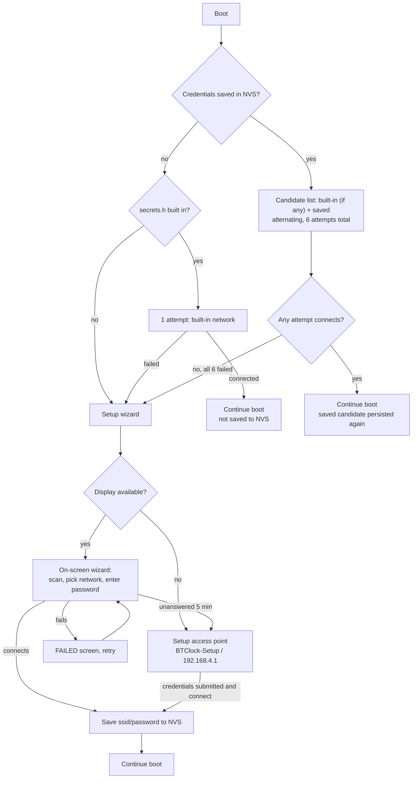

# Wi-Fi boot flow

How `connect_wifi()` (`firmware/src/main.cpp`) decides what to try, and when the setup
wizard takes over. Source of truth is the code; this diagram is a read of it as of commit
`babce59`.

## Notes

* **No saved credentials = never set up.** One quick attempt at the built-in network (if the
  build has one), then straight to the wizard. There is no known-good network yet worth
  waiting for.
* **Saved credentials = patient.** Up to 6 attempts (~3 minutes), alternating between the
  built-in network and the saved one, so a router that boots slower than the device after a
  power cut is still waited for.
* **The built-in network is never written to NVS.** Only a network chosen through the wizard
  (or the headless portal) is persisted, and only once, in `g_ssid`/`g_pass` via
  `wifi_save_credentials()`.
* **Headless** (safe mode, or no display): no on-screen wizard, straight to the
  `BTClock-Setup` access point.
* **With a display:** the wizard reuses the same connect path (`try_candidate` /
  `wifi_start_reconnect_task`); if nobody answers it for 5 minutes, it hands over to the
  access point too, since a screen nobody can use must not be the only way in.
